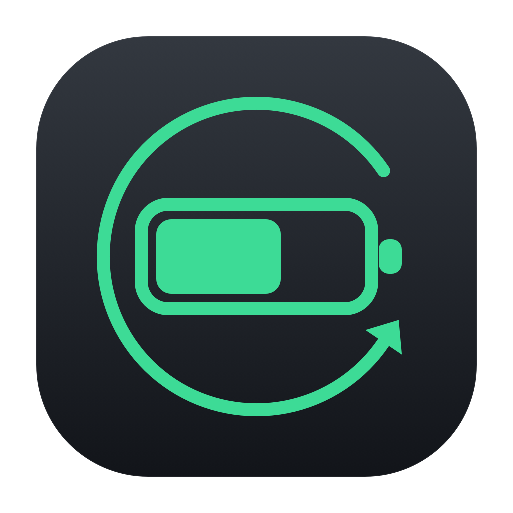

<p align="center">
  
</p>

<h1 align="center">CekBat</h1>

<p align="center">
  Minimal macOS utility for checking MacBook battery health, cycle count, and monthly cycle growth — plus battery status of a connected iPhone.
</p>

---

## Features

- **Live battery status** — charge level, charging state, remaining time, voltage, current, temperature.
- **Battery health** — cycle count, max/design capacity, health percentage, service condition.
- **Device info** — model identifier, chip, memory, macOS version.
- **iPhone inspection** — name, model, iOS version, level, cycle count, health, temperature of a connected iPhone (requires `libimobiledevice`).
- **History** — records cycle count over time and shows the increase per month for both Mac and iPhone.
- **Import coconutBattery history** — reads coconutBattery 4 `.ccba` exports and merges them into the history.
- **Self-check CLI** — `--json`, `--history`, and `--import` for scripting or quick diagnostics.

## Requirements

- macOS 13 or later.
- Xcode Command Line Tools (`xcode-select --install`) — for `swiftc`.
- Optional, for iPhone support: `brew install libimobiledevice`.
- Optional, for importing coconutBattery history: coconutBattery 4 installed (the export key is read from its binary).
- The iPhone must be connected via USB and unlocked; tap **Trust** when prompted.

## Build

```sh
./build.sh
```

Produces `build/CekBat.app`. No Xcode project is required.

## Usage

```sh
open build/CekBat.app
```

Tabs:

| Tab | Contents |
| --- | --- |
| **Now** | Mac battery and device info, plus iPhone when connected |
| **History** | Cycle count increase per month |

CLI:

```sh
build/CekBat.app/Contents/MacOS/CekBat --json      # snapshot as JSON
build/CekBat.app/Contents/MacOS/CekBat --history   # monthly cycle deltas
build/CekBat.app/Contents/MacOS/CekBat --import "coconutBattery Data ios.ccba"
```

## Importing coconutBattery history

Use **Import .ccba…** in the History tab, or `--import <file>`.

The `.ccba` container is an AES-GCM sealed box (key embedded in the coconutBattery binary, read at import time) wrapping LZFSE-compressed JSON. Records are merged by snapshot time, so re-importing the same file is a no-op. Mac snapshots feed the Mac column, all other devices the iPhone column.

## How data is read

| Source | Mechanism |
| --- | --- |
| Mac battery | IOKit — `AppleSmartBattery` registry entry |
| Mac device info | `sysctlbyname` (`hw.model`, `machdep.cpu.brand_string`, `hw.memsize`) |
| iPhone | `ideviceinfo` and `idevicediagnostics ioregentry AppleSmartBattery` |

No privileged access, no private APIs, no network calls.

## History storage

Samples are stored at:

```
~/Library/Application Support/CekBat/history.json
```

A sample is written every 5 seconds only when a cycle count changes or a new month starts. The monthly figure is the difference between the cycle count at the end of a month and the end of the previous month. The first recorded month shows `—` because there is no baseline yet.

Delete the file to reset history.

## Limitations

- Cycle count on iPhone is only available from macOS via `libimobiledevice`; iOS apps have no API for it.
- Imported coconutBattery data is grouped by device type (Mac vs iPhone), not by serial number.
- Battery condition thresholds follow Apple guidance (`Service recommended` at 1000+ cycles). Health is calculated from `AppleRawMaxCapacity / DesignCapacity`.
- History starts empty on first launch; older months cannot be backfilled except from a coconutBattery export.

## Project structure

```
CekBat.swift   UI, battery/device readers, .ccba import, history store
Info.plist     App bundle metadata
build.sh       Compiles and bundles build/CekBat.app
assets/        Branding assets
```

## License

MIT
